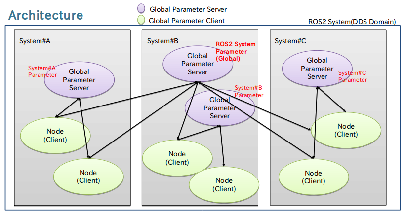

[](https://github.com/fujitatomoya/ros2_persist_parameter_server/actions/workflows/humble.yml) [](https://github.com/fujitatomoya/ros2_persist_parameter_server/actions/workflows/jazzy.yml) [](https://github.com/fujitatomoya/ros2_persist_parameter_server/actions/workflows/kilted.yml) [](https://github.com/fujitatomoya/ros2_persist_parameter_server/actions/workflows/lyrical.yml) [](https://github.com/fujitatomoya/ros2_persist_parameter_server/actions/workflows/rolling.yml)
[](https://github.com/fujitatomoya/ros2_persist_parameter_server/actions/workflows/humble-nightly.yml) [](https://github.com/fujitatomoya/ros2_persist_parameter_server/actions/workflows/jazzy-nightly.yml) [](https://github.com/fujitatomoya/ros2_persist_parameter_server/actions/workflows/kilted-nightly.yml) [](https://github.com/fujitatomoya/ros2_persist_parameter_server/actions/workflows/lyrical-nightly.yml) [](https://github.com/fujitatomoya/ros2_persist_parameter_server/actions/workflows/rolling-nightly.yml)

# ROS2 Persistent Parameter Server

ROS 2 Persistent Parameter Server, that resides in the ROS 2 system to serve the parameter daemon. The other nodes(e.g the client demo provided in the code) can write/read the parameter in Parameter Server, and ***Parameter Server is able to store the parameter into the persistent storage which user can specify such as tmpfs, nfs, or disk.***

See [overview slide deck](https://raw.githack.com/fujitatomoya/ros2_persist_parameter_server/rolling/presentation/ros2_parameter_server.html) for general information.

<!-- TOC -->

- [ROS2 Persistent Parameter Server](#ros2-persistent-parameter-server)
  - [Background](#background)
  - [Overview](#overview)
    - [Persistent Parameter Registration](#persistent-parameter-registration)
      - [Persistent Prefix](#persistent-prefix)
      - [Scope Overview](#scope-overview)
    - [Configurable Options](#configurable-options)
    - [Services](#services)
  - [Sequence](#sequence)
  - [Getting Started](#getting-started)
    - [Supported Distribution](#supported-distribution)
      - [Docker Container](#docker-container)
    - [Dependent Packages](#dependent-packages)
    - [Prerequisites](#prerequisites)
    - [Build](#build)
    - [Run](#run)
  - [Kubernetes](#kubernetes)
  - [Test](#test)
    - [Run](#run-1)
  - [Known Issues](#known-issues)
  - [Authors](#authors)
  - [License](#license)

<!-- /TOC -->

## Background

The discussion is opened [here](https://discourse.ros.org/t/ros2-global-parameter-server-status/10114/13), and centralized parameter server is not a good affinity to ROS 2 distributed system architecture. One of the most valuable things about ROS APIs is that we make sure that the messages have specific semantic meaning so that they can’t be misinterpreted. As we develop the ROS 2 tools and best practices we should make sure to bring that same level of rigor to parameters too for greater reusability and correctness.

Although, it is expected to be the following requirement.

- Global configuration that many nodes share (e.g. RTOS priorities, vehicle dimensions, …)
- Generic ROS 2 system property server.
- Persistent storage support to re-initialize the system. parameters are modified in runtime and cache it into persistent volume as well. and next boot or next re-spawn, modified parameter will be loaded at initialization. (parameter lifetime is dependent on use case, sometimes system lifetime, sometimes node lifetime.)
- Using ROS1 based application with Parameter Server.

## Overview



Generally ROS 2 Parameter Server is simple blackboard to write/read parameters on that. The other nodes can write/read the parameter on the server to share them in the ROS 2 system. there is a new concept for "Persistent Parameter" which is described later.

ROS 2 Parameter Server is constructed on ROS parameter API's, nothing specific API's are provided to connect to the server from the client. Also, about the security it just relies on ROS 2 security aspect.

### Persistent Parameter Registration

#### Persistent Prefix

persistent parameter must have prefix ***"persistent"***

#### Scope Overview

parameter server has the following scope for persistent parameter. since parameter server is built on top of ROS 2 Parameter API, parameter server supports "persistent" parameter based on **/parameter_events** topic.

|  Category  |  Supported  |  Description  |
| ---- | ---- | ---- |
|  Parameter API  |  YES  |  ROS 2 Parameter Client API supported, since this activity can be detected via **/parameter_events**.  |
|  Persistent Parameter File  |  YES  | parameter server dedicated argument to specify the file to load as parameters. in addition, all of the persistent parameters will be stored into this file during shutdown.<br> e.g) --file-path /tmp/parameter_server.yaml |
|  Parameter Arguments  |  NO  |  e.g) --ros-args -p persistent.some_int:=42<br>some_int cannot be registered as persistent parameter, since this cannot be notified via **/parameter_events** to parameter server.  |
|  Parameter File Arguments  |  NO  |  e.g) --ros-args --params-file ./parameters_via_cli.yaml<br>same with parameter arguments, cannot be registered as persistent parameter, since these cannot be notified via **/parameter_events**  to parameter server. |
|  Launch Parameter  |  NO  |  e.g) ros2 launch persist_parameter_server parameter_server.launch.py<br>same with parameter arguments, cannot be registered as persistent parameter, since these cannot be notified via **/parameter_events**  to parameter server.  |

### Configurable Options

- Node Name

  Since ROS 2 parameter is owned by node, node name will be needed to access the parameters, this is designed to clarify semantics for the parameters and owners. Node name will be "parameter_server" if node name is not specifies. so the other nodes can use "parameter_server" as well to access in the same system Parameter Server. If there must exist multiple parameter servers, these parameter servers need to specify a different node name, such as "parameter_server_[special_string]", please notice that ROS 2 node name can only contains alphanumerics and '_'.

- Persistent Volume

  Definition of "Persistent" is different from user and use cases, so it should be configurable to set the path to store the persistent --file-path FILE_PATH parameter. Expecting if the parameter's lifespan is system boot, path would be "/tmp" because user wants a fresh start via reboot. Or maybe physical persistent volume is chosen if users want to keep the parameter into the hardware storage. At the initialization time, Parameter Server will load the parameters from the storage which is specified by user.

- Storing Period

  It sets the interval for periodically saving parameters to the file system, and that setting the value to 0 disables periodic storing.

- Node Options

  there are four important options:
  - allow_undeclared_parameters: (default true)
  - automatically_declare_parameters_from_overrides: (default true)
  - allow_dynamic_typing: (default false)
  - save-on-update: (default false)
all of the configuration options will be passed via arguments as following.

<table>
    <thead>
        <tr>
            <th>Options</th>
            <th>CLI</th>
            <th>Description</th>
        </tr>
    </thead>
    <tbody>
        <tr>
            <td>Node Name</td>
            <td>--ros-args --remap __node:=NODENAME</td>
            <td>in default, "parameter_server" will be used.</td>
        </tr>
        <tr>
            <td>Help</td>
            <td>--help</td>
            <td>show usage.</td>
        </tr>
        <tr>
            <td>File Path</td>
            <td>--file-path FILE_PATH</td>
            <td>in default, "/tmp/parameter_server.yaml" will be used. if specified, that path will be used to store/load the parameter yaml file.</td>
        </tr>
        <tr>
        <tr>
            <td>Storing Period</td>
            <td>--storing-period STORING_PERIOD</td>
            <td>Specifies the interval (in seconds) for periodically storing persistent parameters to the file system. A value of 0 disables periodic storing.</td>
        </tr>
        </tr>
        <tr>
            <td rowspan=4>Node Options</td>
            <td>--allow-declare true/false</td>
            <td>default enabled, if specified allow any parameter name to be set on parameter server without declaration by itself. Otherwise it does not.</td>
        </tr>
        <tr>
            <td>--allow-override true/false</td>
            <td>default enabled, if specified true iterate through the node's parameter overrides or implicitly declare any that have not already been declared.</td>
        </tr>
        <tr>
            <td>--allow-dynamic-typing true/false</td>
            <td>Enables dynamic typing for parameters, allowing their types to be changed after declaration.</td>
        </tr>
        <tr>
            <td>--save-on-update true/false</td>
            <td>Saves parameter file each time the value of a parameter is changed.</td>
        </tr>
    </tbody>
</table>

### Services

- `~/reload_params`: Reloads the parameters from the configuration file. This service allows dynamic reconfiguration of the node without requiring a restart. When called, the parameter server will reload the parameter values and apply them to the current operation.
- `~/save_params`: Saves the current persistent parameter values to persistent storage (typically a configuration file). This service ensures that parameter changes made during runtime are preserved and will be available after node restart or system reboot.

## Sequence

1. parameter server is initialized via __params:=<xxx.yaml>
   this is just a initial parameter(not persistent) to load into the parameter server's memory.
2. parameter server loads parameter specified yaml file via --file-path.
   and then parameter server will overwrite or declare parameters.
   (*) at #1 parameters might be overwritten.
3. parameter server starts the main loop with callback for parameter changes.
4. if the parameter changes are on "/persistent" that will be stored in storage at this time.
5. at the finalization, flash all of the "/persistent" parameters into the file system.

## Getting Started

Tutorial Video is provided by [The Construct Robotics Institute](https://www.theconstruct.ai/).

[](https://www.youtube.com/watch?v=1xYjYd3wTKo)

### [Supported Distribution](https://docs.ros.org/en/rolling/Releases.html)

| Distribution      | Supported | Branch |
| :---------------- | :-------- | :--- |
| Rolling Ridley    |    ✅    | [`rolling`](https://github.com/fujitatomoya/ros2_persist_parameter_server/tree/rolling) (default) |
| Lyrical Luth      |    ✅    | [`lyrical`](https://github.com/fujitatomoya/ros2_persist_parameter_server/tree/lyrical) |
| Kilted Kaiju      |    ✅    | [`kilted`](https://github.com/fujitatomoya/ros2_persist_parameter_server/tree/kilted) |
| Jazzy Jalisco     |    ✅    | [`jazzy`](https://github.com/fujitatomoya/ros2_persist_parameter_server/tree/jazzy) |
| Humble Hawksbill  |    ✅    | [`humble`](https://github.com/fujitatomoya/ros2_persist_parameter_server/tree/humble) |

#### Docker Container

see available images for [tomoyafujita/ros2_param_server@dockerhub](https://hub.docker.com/repository/docker/tomoyafujita/ros2_param_server/general)

```bash
docker run -it --rm --net=host tomoyafujita/ros2_param_server:humble
```

### Dependent Packages

```bash
apt install libyaml-cpp-dev libboost-program-options-dev libboost-filesystem-dev
```

### Prerequisites

[ROS 2 source build environment](http://docs.ros.org/en/rolling/Installation/Alternatives/Ubuntu-Development-Setup.html) is required to build and run the parameter server.

### Build

Install local colcon workspace,

```bash
# cd <colcon_workspace>/src
# git clone -b <ROS_DISTRO> https://github.com/fujitatomoya/ros2_persist_parameter_server
# cd <colcon_workspace>
# colcon build --symlink-install --packages-select persist_parameter_server
# source install/local_setup.bash
```

### Run

1. start parameter server.

   ```bash
   # cp <colcon_workspace>/src/ros2_persist_parameter_server/server/param/parameter_server.yaml /tmp/
   # ros2 run persist_parameter_server server
   [INFO] [parameter_server]: Parameter Server node named: '/parameter_server' started and ready, and serving '9' parameters already!
   ...<snip>
   ```

2. update persistent parameter.

   ```console
   $ ros2 param set /parameter_server persistent.some_int 81
   Set parameter successful
   $ ros2 param set /parameter_server persistent.a_string Konnichiwa
   Set parameter successful
   $ ros2 param set /parameter_server persistent.pi 3.14159265359
   Set parameter successful
   $ ros2 param set /parameter_server persistent.some_lists.some_integers "[81, 82, 83, 84]"
   Set parameter successful
   ```

3. restart parameter server.

   ```bash
   # ros2 run persist_parameter_server server
   [INFO] [parameter_server]: Parameter Server node named: '/parameter_server' started and ready, and serving '9' parameters already!
   ...<snip>
   ```

4. check persistent parameter is precisely cached and loaded into parameter server.

   ```console
   $ ros2 param get /parameter_server persistent.a_string
   String value is: Konnichiwa
   $ ros2 param get /parameter_server persistent.pi
   Double value is: 3.14159265359
   $ ros2 param get /parameter_server persistent.some_int
   Integer value is: 81
   $ ros2 param get /parameter_server persistent.some_lists.some_integers
   String value is: 81,82,83,84
   ```

## Kubernetes

persistent parameter server can be deployed with Kubernetes deployment and configmap resources.
Please see [How to deploy the parameter server with Kubernetes](./k8s/k8s_tutorial.md) for more information.

## Test

Unit and system tests are integrated into the package with `ament_add_gtest` (`test/test_parameter_server.cpp`), so that they run with `colcon test` aligned with the other ROS 2 packages.
Each test runs the parameter server node in-process and drives it with a parameter client node, exactly as an external node would do.
Restarting the server node in the test flushes the persistent parameters into the file and loads them back, which is equivalent to restarting the server process.

These tests verify the following functions.

- persistent parameter can be read/stored to/from the file system.
- persistent parameter can be read/modified from parameter client.
- non-persistent parameter cannot be read/stored to/from the file system.
- non-persistent parameter can be read/modified from parameter client.
- parameter type can be changed dynamically only when allow-dynamic-typing is set.
- `~/save_params` and `~/reload_params` services store and reload the persistent parameters.
- save-on-update stores the persistent parameters immediately when they are changed.
- `must_save_on_update`, `storing_period` and `allow_dynamic_typing` server parameters can be changed at runtime.
- double and double array parameters keep their precision in the file system.
- invalid persistent parameter file is rejected at startup.

The linters from [ament_lint_common](https://github.com/ament/ament_lint) (uncrustify, cpplint, cppcheck, copyright, flake8, pep257, lint_cmake and xmllint) are also executed via `colcon test`.

### Run

```bash
# cd <colcon_workspace>
# colcon build --symlink-install --packages-select persist_parameter_server
# colcon test --packages-select persist_parameter_server --event-handlers console_direct+
# colcon test-result --all --verbose
```

All of the tests are listed with result as following.

```console
...<snip>
[----------] 13 tests from ParameterServerTest
[ RUN      ] ParameterServerTest.load_parameters_from_yaml_file
[       OK ] ParameterServerTest.load_parameters_from_yaml_file (xx ms)
[ RUN      ] ParameterServerTest.persistent_parameters_survive_restart
[       OK ] ParameterServerTest.persistent_parameters_survive_restart (xx ms)
[ RUN      ] ParameterServerTest.parameter_type_change_is_rejected_by_default
[       OK ] ParameterServerTest.parameter_type_change_is_rejected_by_default (xx ms)
[ RUN      ] ParameterServerTest.save_and_reload_services
[       OK ] ParameterServerTest.save_and_reload_services (xx ms)
[ RUN      ] ParameterServerTest.double_precision_is_preserved
[       OK ] ParameterServerTest.double_precision_is_preserved (xx ms)
[ RUN      ] ParameterServerTest.dynamic_typing_allows_type_change
[       OK ] ParameterServerTest.dynamic_typing_allows_type_change (xx ms)
[ RUN      ] ParameterServerTest.save_on_update_stores_immediately
[       OK ] ParameterServerTest.save_on_update_stores_immediately (xx ms)
[ RUN      ] ParameterServerTest.save_on_update_can_be_changed_dynamically
[       OK ] ParameterServerTest.save_on_update_can_be_changed_dynamically (xx ms)
[ RUN      ] ParameterServerTest.storing_period_can_be_changed_dynamically
[       OK ] ParameterServerTest.storing_period_can_be_changed_dynamically (xx ms)
[ RUN      ] ParameterServerTest.allow_dynamic_typing_can_be_changed_dynamically
[       OK ] ParameterServerTest.allow_dynamic_typing_can_be_changed_dynamically (xx ms)
[ RUN      ] ParameterServerTest.missing_yaml_file_is_tolerated
[       OK ] ParameterServerTest.missing_yaml_file_is_tolerated (xx ms)
[ RUN      ] ParameterServerTest.yaml_file_keyed_by_node_name
[       OK ] ParameterServerTest.yaml_file_keyed_by_node_name (xx ms)
[ RUN      ] ParameterServerTest.invalid_yaml_file_throws
[       OK ] ParameterServerTest.invalid_yaml_file_throws (xx ms)
[----------] 13 tests from ParameterServerTest (xx ms total)

[----------] Global test environment tear-down
[==========] 13 tests from 1 test suite ran. (xx ms total)
[  PASSED  ] 13 tests.
...<snip>
Summary: xx tests, 0 errors, 0 failures, 0 skipped
```

## Known Issues

- [Signal2(2) needs to be injected to the server executable](https://github.com/fujitatomoya/ros2_persist_parameter_server/issues/24)
  - Because of https://github.com/ros2/ros2cli/pull/899 and [What is main process in container](https://docs.docker.com/engine/containers/multi-service_container/), signal (SIGINT/SIGTERM) does not directly go to the server process. This causes the server not to store the persistent parameters in the file system, since the server expects the signal to shutdown the process and store the all persistent parameters in the specified file system.
  - The work-around is that, configure container main process with the server executables (not using `ros2 run` until https://github.com/ros2/ros2cli/pull/899 is solved) or send the signal from the host system to the server process in the container using `docker exec <YOUR CONTAINER> kill -SIGINT <SERVER PID IN CONTAINER>`.

## Authors

- **Tomoya Fujita** --- Tomoya.Fujita@sony.com / tomoya.fujita825@gmail.com
- **Barry Xu** --- Barry.Xu@sony.com

## License

Apache 2.0
