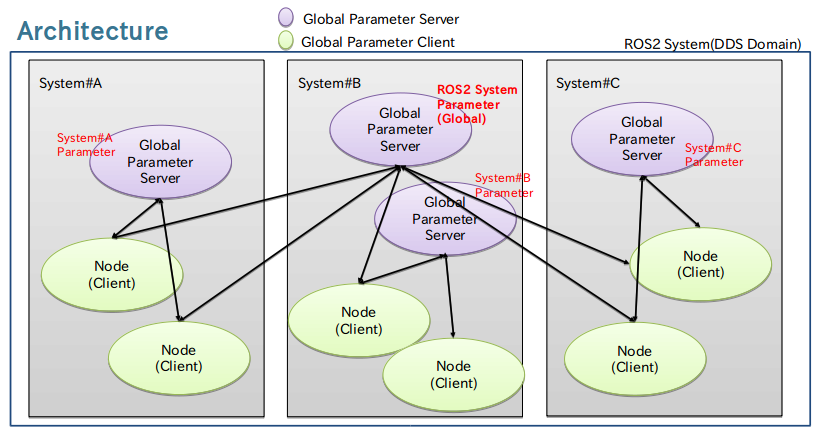

## [ROS 2 Persistent Parameter Server](https://github.com/fujitatomoya/ros2_persist_parameter_server)


- ROS 1 parameter serverからインスピレーションを得て開発。
- このグローバルサーバーで任意のパラメータを設定/取得可能。
- パラメータをストレージに保存/読み込み可能。

<!---
Comment Here
--->

---


<!---
Supported platforms
--->

---

## Why we need this?

- 多くのノードが共有するグローバル設定（例：システム設定や構成など）
- 汎用的なROS 2システムやlocalhost全体のパラメータサーバー。
- <span style="color:red;">永続化ストレージによるシステムの再初期化サポート。</span>
    - **パラメータは実行時に変更され、永続化ボリュームにキャッシュされます。次回起動や再起動時には、変更されたパラメータが初期化時に読み込まれます。（パラメータの寿命はユースケースに依存し、システム寿命の場合もあれば、ノード寿命の場合もあります。）**
- Parameter Serverを使用するROS 1ベースのアプリケーションとの互換性。

<!---
Comment Here
--->

---



---

## How to Run

- Docker

```console
$ docker run -it tomoyafujita/ros2_param_server:rolling /bin/bash
root@bf4d904e3800:~/colcon_ws# ros2 run persist_parameter_server server
```

- Kubernetes

```console
$ kubectl apply -f ./k8s/parameters.yaml
$ kubectl apply -f ./k8s/deployment.yaml
```

<!---
Comment Here
--->

---

## Issues and PRs are always welcome 🚀

https://github.com/fujitatomoya/ros2_persist_parameter_server


<!---
Comment Here
--->

